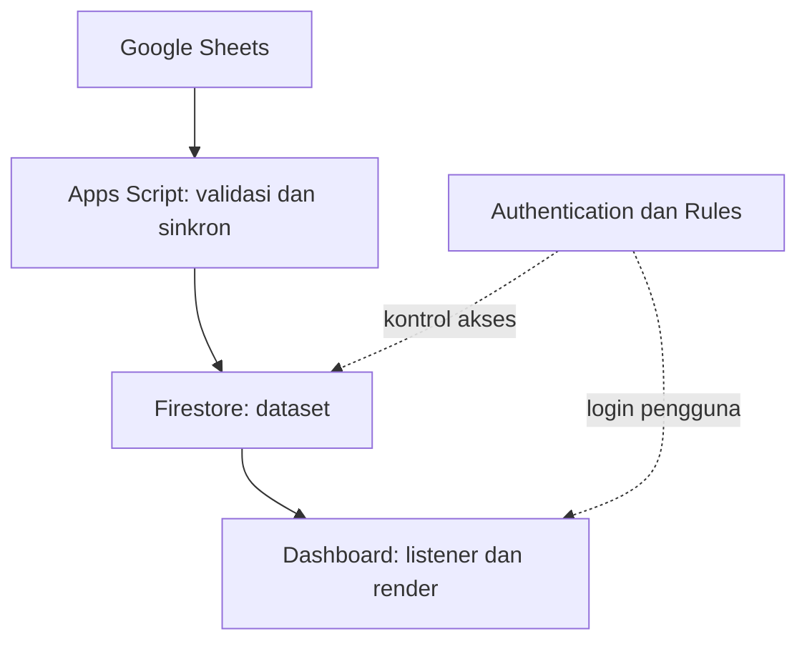

# Panduan Membangun Dashboard Realtime dari Google Sheets

**Acuan implementasi: dashboard profitabilitas berbasis Apps Script, Firebase, dan GitHub Pages**  
Penyusun: Rehana Putri • Versi 1.0 • 25 November 2026

## 1. Tujuan dan batas penggunaan

Dokumen ini menjadi acuan untuk mengembangkan dashboard baru atau menambahkan pembaruan otomatis pada dashboard yang sudah ada. Pembaca diharapkan mampu menghubungkan spreadsheet terbatas ke dashboard tanpa menanam data operasional atau password ke HTML publik.

Panduan berangkat dari pengalaman proyek profitabilitas. Petunjuk konfigurasi dapat digunakan kembali; pemetaan kolom, rumus bisnis, validasi, dan render chart harus disesuaikan dengan dashboard tujuan. Dokumen ini adalah panduan implementasi dan serah terima, bukan paket aplikasi siap dijalankan: kode lengkap proyek tetap menjadi dependensi yang harus disediakan di repository tim.

Pada proyek asal, pengguna telah mengonfirmasi pembaruan otomatis dalam pengujian sebelumnya, sekitar beberapa detik pada edit manual. Untuk perpindahan ke Firebase rekan tim, koneksi login dilaporkan berhasil; penerimaan data dan pembaruan halaman produksi perlu dibuktikan melalui pengujian akhir di bagian 12. Jangan menganggap hasil proyek asal otomatis membuktikan deployment baru.

## 2. Arsitektur dan arti realtime

| Tahap | Komponen | Tanggung jawab |
|---|---|---|
| Sumber | Google Sheets | Menyimpan data yang dikelola petugas berwenang |
| Integrasi | Apps Script terikat spreadsheet | Membaca, menormalisasi, memvalidasi, dan mengirim dataset |
| Penyimpanan | Cloud Firestore | Menyimpan dataset terbaru dan metadata sinkron |
| Autentikasi | Firebase Authentication | Memverifikasi akun Sync dan pengguna dashboard |
| Otorisasi | Firestore Security Rules | Memutuskan siapa boleh membaca atau menulis |
| Penyajian | HTML/JavaScript di GitHub Pages | Mendengarkan perubahan dan memperbarui angka/chart |



Firestore menyediakan listener perubahan. Namun jalur spreadsheet menuju Firestore tetap membutuhkan waktu eksekusi Apps Script. Edit manual dapat memicu sinkron langsung; perubahan akibat rumus, impor, skrip, atau API tidak boleh diasumsikan memicu event edit yang sama. Pemeriksaan berkala menjadi cadangan. Interval satu menit bukan jaminan data tampil tepat dalam 60 detik; penjadwalan, perhitungan spreadsheet, jaringan, dan antrean memengaruhi keterlambatan.

Tidak diperlukan backend khusus atau Cloud Functions untuk pola ini. Firebase sendiri tetap berada dalam ekosistem Google Cloud; istilah “tanpa Google Cloud” tidak berarti tidak ada project Cloud di belakang Firebase.

## 3. Persiapan dan keputusan awal

Siapkan akses edit spreadsheet, hak mengelola Firebase, akses repository dan Pages, serta pemilik operasional untuk memelihara trigger. Tentukan satu lingkungan uji sebelum produksi.

Isi lembar konfigurasi berikut tanpa password:

| Parameter | Contoh generik | Lokasi penggunaan |
|---|---|---|
| Project ID | `dashboard-contoh` | Apps Script, config web, Firebase CLI bila dipakai |
| Dataset ID | `dataset-utama` | Script, listener, dan rules |
| Spreadsheet | Nama dokumen internal | Script terikat dokumen |
| Sheet sumber | `Summary`, `Detail` | Pembaca dataset |
| Domain web | `organisasi.github.io` | Konfigurasi autentikasi sesuai alur login |
| Akun Sync | Email operasional khusus | Authentication dan Script Properties |
| Pemilik trigger | Akun Google pengelola | Apps Script installable triggers |

Project ID, nama pengguna, dan nama aplikasi adalah hal berbeda. API Key juga bukan UID. Jangan menyalin UID pengguna ke properti API Key.

## 4. Inventaris file dan tempat menjalankannya

| File/komponen | Fungsi | Tempat perubahan mulai berlaku |
|---|---|---|
| `index.html` | Halaman awal atau pengalihan | Setelah deploy web |
| HTML dashboard | Login, listener, filter, KPI, chart | Setelah deploy web |
| `firebase-config.js` | Identitas aplikasi Firebase web | Setelah deploy web |
| `apps-script/Code.gs` | Salinan sumber integrasi | Harus disalin/disinkronkan ke Apps Script |
| `apps-script/appsscript.json` | Manifest izin dan zona waktu | Harus disalin/disinkronkan ke Apps Script |
| `firestore.rules` | Aturan akses dan bentuk data | Setelah Publish di Console atau deploy rules |
| `firebase.json`, `.firebaserc` | Konfigurasi Firebase CLI opsional | Ketika menjalankan perintah CLI |
| Script Properties | Kredensial dan status runtime | Setelah disimpan pada project Apps Script yang benar |

Mengubah `Code.gs` di GitHub tidak otomatis memperbarui Apps Script. Menyimpan `firestore.rules` di GitHub juga tidak otomatis menerbitkan rules. GitHub Pages menyajikan web statis dan tidak menjalankan `.gs`.

Sebagian versi dashboard memiliki konfigurasi Firebase langsung di HTML, sebagian memuat `firebase-config.js`. Periksa kode aktual. Jangan membuat dua sumber konfigurasi yang tidak konsisten.

## 5. Menyiapkan Firebase

### 5.1 Project dan aplikasi web

1. Buat atau pilih Firebase project yang ditetapkan sebagai tujuan.
2. Buka Project settings → General → Your apps, lalu daftarkan aplikasi web jika belum ada.
3. Pada konfigurasi aplikasi web, salin objek `firebaseConfig` langsung melalui tombol salin. Hindari mengetik API Key dari foto karena `O/0` dan `I/l` mudah tertukar.
4. Salin properti yang diperlukan ke `firebase-config.js` di VS Code, atau lokasi config yang memang dibaca HTML.
5. Pastikan nama objek global cocok dengan loader dashboard. Contoh berikut hanya untuk dashboard yang membaca `window.FIREBASE_CONFIG`:

```js
window.FIREBASE_CONFIG = {
  apiKey: "SALIN_DARI_FIREBASE",
  authDomain: "dashboard-contoh.firebaseapp.com",
  projectId: "dashboard-contoh",
  storageBucket: "SALIN_DARI_FIREBASE",
  messagingSenderId: "SALIN_DARI_FIREBASE",
  appId: "SALIN_DARI_FIREBASE"
};
```

Nilai di atas adalah placeholder dan tidak dapat digunakan untuk login. Konfigurasi web Firebase bukan password dan memang digunakan browser; perlindungan data tetap bergantung pada autentikasi dan rules. Pembatasan API Key harus sesuai layanan dan jenis klien. Jangan menghapus pembatasan sembarangan hanya untuk menghilangkan error.

### 5.2 Authentication dan Firestore

1. Buka Authentication → Sign-in method, aktifkan Email/Password.
2. Periksa Authorized domains untuk alur autentikasi yang digunakan. Domain deployment ditulis sebagai hostname, tanpa `https://` dan tanpa path repository. Pengaturan domain tidak memperbaiki error `API_KEY_INVALID` pada login REST Apps Script.
3. Buat Cloud Firestore database jika belum ada. Pilih lokasi sesuai kebutuhan organisasi; gunakan database default jika endpoint kode menunjuk `(default)`.
4. Jangan membuka akses publik sementara sebagai cara memperbaiki koneksi.

### 5.3 Dua akun aplikasi dengan fungsi berbeda

| Akun | Tugas | Profil |
|---|---|---|
| Manusia | Login dan membaca dashboard | Peran manusia sesuai kewenangan |
| Sync | Apps Script mengirim dataset | `role: "Sync"`, `active: true` |

Ini dua akun Firebase Authentication, bukan kewajiban memakai dua akun Google di laptop. Akun Google pemilik trigger adalah identitas lain yang menjalankan Apps Script.

Untuk setiap akun: Authentication → Users → Add user, tentukan email/password, lalu salin UID. Di Firestore, buat `users/{UID}` dengan Document ID sama persis dengan UID Authentication. Field minimal: `email` string, `name` string, `role` string, dan `active` boolean. `true` harus boolean, bukan teks `"true"`.

Untuk administrator pertama, profil dapat dibuat melalui Console oleh pengelola project. Jangan mengandalkan pengguna baru membuat sendiri profil Director melalui web. Role Sync tidak membuka dashboard. Pesan “akun belum diaktifkan” dapat muncul karena aplikasi menolak role, bukan semata-mata karena `active` false.

Password Firebase Authentication tidak dapat dibaca kembali melalui Console. Password pada Script Properties hanya nilai tersimpan, bukan bukti bahwa nilainya benar. Jika lupa, reset akun atau buat akun Sync baru beserta profil UID baru.

## 6. Kontrak data dan aturan akses

Pada implementasi profitabilitas, dokumen resmi adalah `datasets/segment3-ytd2026`. Untuk proyek lain, tentukan ID baru secara konsisten.

| Field dokumen | Bentuk | Makna |
|---|---|---|
| `json` | string JSON | Payload yang dipahami dashboard |
| `source` | string | Identitas sumber yang layak ditampilkan |
| `clients` | integer | Jumlah pelanggan pada model profitabilitas |
| `hash` | string opsional | Sidik isi untuk menghindari kirim ulang |
| `updatedAt` | server timestamp | Waktu commit yang berhasil |
| `updatedBy` | string email | Email akun pengirim terautentikasi |

`clients` adalah konsep khusus proyek asal. Untuk dashboard SDM atau traffic, definisikan kontrak baru yang sesuai dan ubah script, rules, serta pembaca web bersama-sama. Jangan hanya mengganti nama sheet.

Rules proyek asal memvalidasi daftar field, tipe, ukuran payload, `updatedAt == request.time`, dan `updatedBy == request.auth.token.email`. Pengiriman REST perlu memakai transform server timestamp untuk field waktu yang diperiksa terhadap `request.time`; jam lokal Apps Script bukan pengganti yang andal.

Kebijakan asal: pengguna manusia aktif dapat membaca dataset; Sync aktif hanya boleh membuat/memperbarui dataset resmi; Director/Finance juga memiliki hak menulis sesuai desain portal; penghapusan dataset dibatasi Director. Audit memiliki aturan tersendiri. Karena dataset dan audit dapat dikirim dalam commit atomik, penolakan audit dapat menggagalkan seluruh commit.

Salin rules lengkap yang telah ditinjau dari repository ke Firestore → Rules → Publish. Alternatif CLI: pilih project yang benar dan deploy hanya Firestore rules. Catat waktu penerbitan dan uji akun diizinkan maupun ditolak. Jangan memakai contoh rules terbuka seperti `allow read, write: if true`.

Kontrol tampilan menu saja bukan keamanan. Jika semua pengguna menerima JSON lengkap, menyembunyikan modul tidak membatasi akses ke bagian data tersebut. Untuk pembatasan pelanggan/divisi, pisahkan data atau terapkan akses pada dokumen yang memang bisa dibatasi rules.

## 7. Menyiapkan Apps Script pada spreadsheet

1. Buka spreadsheet sumber → Extensions → Apps Script.
2. Ganti isi `Code.gs` dengan sumber integrasi yang ditinjau. Jangan membungkus seluruh file dalam `function myFunction() { ... }`.
3. Set `CFG.PROJECT_ID`, `CFG.DATASET_ID`, dan nama sheet sesuai lingkungan.
4. Bila memakai manifest dari repository, tampilkan `appsscript.json` melalui Project Settings dan sesuaikan izin serta zona waktu. Jangan mengarang manifest berbeda dari kebutuhan kode.
5. Simpan lalu muat ulang spreadsheet agar menu `Profitability Sync` muncul.
6. Pilih menu `1. Atur koneksi Firebase`, isi API Key project tujuan, email akun Sync, dan password Firebase akun tersebut. Jalankan otorisasi Google bila diminta.
7. Pilih `Sinkronkan sekarang`, lalu cocokkan log dan Firestore sebelum mengaktifkan otomatis.
8. Pilih `2. Aktifkan sinkron otomatis` melalui akun Google pengelola yang ditetapkan.

Untuk pola bound script ini tidak perlu menerbitkan Apps Script sebagai web app. Trigger installable menjalankan integrasi dengan otorisasi pembuat trigger. Jika ada beberapa pengelola, periksa pemicu dari masing-masing akun agar tidak ada pengiriman ganda; satu akun tidak selalu melihat trigger milik akun lain.

### Properti runtime

| Property | Isi | Perlakuan |
|---|---|---|
| `FIREBASE_API_KEY` | Web API Key project tujuan | Nilai saja, tanpa label atau tanda kutip |
| `SYNC_EMAIL` | Email akun Sync Authentication | Harus berasal dari project tujuan |
| `SYNC_PASSWORD` | Password Firebase akun Sync | Rahasiakan; jangan commit |
| `LAST_HASH` | Hash pengiriman terakhir | Status internal, bukan kredensial |
| `LAST_SYNC` | Catatan waktu sukses terakhir | Tidak membuktikan koneksi saat ini |
| `DIRTY` | Penanda perubahan menunggu | Status penjadwalan |

Lokasi edit: Apps Script → Project Settings → Script Properties. Nama property tidak diganti dengan isinya. Pada menu pengaturan versi proyek ini, input kosong mempertahankan nilai lama. Isi ketiga nilai secara eksplisit ketika memindahkan project. Batasi siapa yang menjadi editor script karena Script Properties bukan penyimpanan rahasia yang terisolasi dari editor project.

## 8. Logika sinkron yang dapat digunakan kembali

Pisahkan empat tanggung jawab: pembacaan sumber, transformasi/validasi, pengiriman, dan pencatatan hasil. Jadikan fungsi pembentuk dataset sebagai adapter yang diganti untuk dashboard lain.

Pada proyek asal, Summary menyediakan angka resmi per pelanggan; Breakdown Pareto menyediakan rincian beban; Rekap SAP S3 menyediakan periode, tren, dan catatan. Aturan koreksi label merupakan logika bisnis khusus, bukan kemampuan umum yang boleh diterapkan ke seluruh dataset.

Prinsip implementasi:

1. Baca rentang data secara batch agar tidak membuat panggilan sel berulang.
2. Normalisasi angka, tanggal, nama, dan nilai kosong secara eksplisit. Jangan diam-diam mengubah angka yang gagal dibaca menjadi nol.
3. Validasi schema dan total kontrol sebelum mengirim.
4. Hitung hash dari isi stabil. Keluarkan `generatedAt` atau waktu pembuatan dari input hash agar data identik tidak selalu dianggap berubah.
5. Gunakan script lock agar sinkron manual dan otomatis tidak saling bertabrakan.
6. Pada edit manual, coba sinkron langsung. Abaikan edit sheet log dan hindari menangani event EDIT yang sama dua kali melalui onEdit serta onChange.
7. Sediakan trigger waktu untuk menghitung ulang sumber rumus/impor dan mencoba ulang kegagalan. Jangan hanya memeriksa flag edit karena sebagian pembaruan tidak menghasilkan event edit.
8. Jika lock gagal atau pengiriman ditolak, pertahankan penanda agar pemeriksaan berikutnya dapat mencoba lagi.
9. Catat sukses setelah commit benar-benar diterima. Simpan error tanpa token/password. Tangani respons HTTP non-2xx secara eksplisit.

Token login dapat dicache untuk mengurangi login berulang, tetapi harus diinvalidasi saat identitas/project diganti. Jangan menyimpan token dalam repository atau menampilkan isi respons login sukses karena berisi token.

Sumber spreadsheet tidak harus berubah untuk mengaktifkan realtime. Dalam desain asal, penulisan Sheets terbatas pada log sinkronisasi. Tinjau pemanggilan mutasi seperti `setValue`, `setValues`, `clear`, dan `deleteRows` pada versi kode aktual sebelum menyatakan sumber aman. Izin OAuth yang luas bukan bukti bahwa kode hanya membaca.

## 9. Menghubungkan web ke perubahan Firestore

Setelah login, web memeriksa profil aktif dan role yang diizinkan, kemudian memasang listener pada dokumen resmi. Listener harus memanggil pembaruan state dan render, bukan hanya mencetak data ke console.

Contoh kerangka Firebase Web SDK modular berikut bukan salinan siap tempel untuk dashboard lama yang menggunakan API compat. `db`, fungsi SDK, validator, dan fungsi render harus disediakan oleh aplikasi:

```js
let stopDatasetListener = null;

function startDatasetListener() {
  stopDatasetListener?.();
  stopDatasetListener = onSnapshot(
    doc(db, "datasets", DATASET_ID),
    (snapshot) => {
      if (!snapshot.exists()) {
        showDataError("Dataset belum tersedia");
        return;
      }
      try {
        const envelope = snapshot.data();
        const data = JSON.parse(envelope.json);
        validateDashboardData(data);
        updateDashboardState(data);
        renderDashboard();
        showLastUpdated(envelope.updatedAt);
      } catch (error) {
        showDataError("Format dataset tidak sesuai");
      }
    },
    (error) => showDataError(error.code)
  );
}

function stopListeningOnLogout() {
  stopDatasetListener?.();
  stopDatasetListener = null;
  clearDashboardState();
}
```

Pastikan render memperbarui KPI, tabel, filter yang relevan, dan chart tanpa membuat instance chart menumpuk. Pertahankan filter yang masih valid. Tampilkan kondisi memuat, kosong, error izin, serta waktu data terakhir. Label “Live” saja tidak membuktikan sinkron end-to-end atau bahwa data berasal dari server terbaru.

Pada versi proyek asal, mode unggahan pribadi dapat sengaja menahan penggantian data resmi. Jika angka tidak berubah, periksa apakah dashboard masih berada pada mode upload, bukan dataset resmi.

## 10. Deploy GitHub Pages

1. Simpan sumber web sebagai file yang sudah diekstrak; jangan hanya upload ZIP. Browser tidak memuat JS di dalam ZIP sebagai asset biasa.
2. Periksa tidak ada password, token, private key, atau data keuangan tertanam di HTML/JS/README.
3. Pastikan `index.html` dan path asset sesuai folder publikasi; gunakan path relatif yang bekerja pada URL subfolder repository.
4. Commit/push ke branch publikasi, lalu pilih Settings → Pages → sumber deploy yang ditentukan tim, misalnya branch `main` dan folder root.
5. Tunggu proses Pages/Actions berhasil, lalu buka URL produksi dan lakukan hard refresh untuk memastikan sumber web terbaru dimuat.
6. Login dengan akun manusia berperan aktif; jangan memakai akun Sync untuk menilai akses dashboard.

Contoh siklus pembaruan lokal, setelah memastikan remote benar:

```bash
git status
git remote -v
git add index.html firebase-config.js dashboard.html
git commit -m "Hubungkan dashboard ke dataset realtime"
git push origin main
```

Nama `dashboard.html` di contoh harus diganti dengan nama file aktual. Jika push ditolak karena remote punya perubahan, gabungkan perubahan dengan hati-hati dan selesaikan konflik. Jangan memakai force push sebagai solusi umum.

Pages pada repo publik tersedia dalam paket Free; kemampuan memakai repo privat bergantung paket pemilik repository. Repo privat tidak otomatis menjadikan halaman web atau JavaScript yang dikirim ke browser privat. Periksa kebijakan organisasi sebelum mempublikasikan dashboard.

## 11. Memindahkan project dan memakai sumber yang sama

| Skenario | Perubahan yang diperlukan |
|---|---|
| Project Firebase sama, akun Sync diganti | Email/password script; profil UID akun baru; tidak perlu mengganti config web |
| Spreadsheet sama, tujuan Firebase diganti | Project ID script, API Key dan akun tujuan; config web harus cocok dengan Firebase yang dibaca dashboard |
| Web sudah mengarah ke Firebase tujuan | Tidak perlu mengubah HTML hanya karena akun Sync diganti |
| Dataset ID diganti | Ubah script, listener, dan izin rules yang membatasi ID |
| Domain hosting diganti | Deploy/path web, serta pengaturan autentikasi yang relevan |
| Model data diganti | Adapter sumber, schema, rules, KPI, chart, dan pengujian |

Satu konfigurasi script yang menunjuk satu project hanya mengirim ke project itu. Mengubah tujuannya menghentikan pembaruan project lama dari jalur tersebut. Jika dua dashboard membaca project yang sama, keduanya dapat menerima dataset yang sama dengan kontrol akses masing-masing. Jika dua Firebase berbeda harus menerima pembaruan sekaligus, rancang pengiriman multi-tujuan secara eksplisit dengan kredensial, hash, log, dan hasil retry terpisah per project.

Saat migrasi, hentikan trigger sementara, catat konfigurasi lama tanpa password dalam dokumentasi publik, ganti seluruh identitas tujuan, lalu invalidasi token cache. Karena data sumber bisa identik, hash lama dapat menyebabkan sinkron otomatis dilewati di tujuan baru. Gunakan jalur manual yang benar-benar mengirim, atau reset status hash terkontrol setelah memastikan tujuan baru, lalu buktikan dokumen tujuan terisi. Aktifkan trigger setelah pengiriman manual lolos.

## 12. Pengujian penerimaan

Gunakan dataset uji atau perubahan yang disetujui pemilik data. Catat nilai awal dan pulihkan setelah pengujian. Jangan mengubah data produksi diam-diam.

| Uji | Tindakan | Bukti lulus |
|---|---|---|
| Login Sync | Jalankan pengaturan koneksi | Login diterima, tanpa memaparkan token |
| Kirim manual | Sinkronkan sekarang | Log sukses baru dan timestamp Firestore baru |
| Identitas tujuan | Periksa Console project tujuan | Dataset benar, pengirim sesuai akun Sync |
| Edit manual | Ubah satu angka yang dibaca adapter | JSON dan total berubah; web mengikuti tanpa reload |
| Rumus/impor | Ubah input yang menghasilkan nilai sumber | Pemeriksaan cadangan menangkap perubahan |
| Tidak ada perubahan | Jalankan pemeriksaan ulang | Tidak ada kirim ulang hanya karena waktu pembuatan |
| Dua sesi | Buka dua browser/perangkat | Keduanya menerima pembaruan |
| Hak baca | Login akun manusia aktif | Dashboard dapat membaca dataset |
| Hak ditolak | Login Sync ke portal/akun nonaktif | Akses dashboard ditolak sesuai desain |
| Putus koneksi | Putus jaringan dan pulihkan | Status jujur; listener pulih atau error ditangani |
| Pemulihan | Kembalikan nilai uji | Firestore dan dashboard kembali sesuai sumber |

Bandingkan angka penuh. Angka ringkas seperti Rp19,55 M dapat terlihat sama meski nilai detail telah berubah. Periksa juga rentang tanggal dan filter pelanggan.

Catat waktu edit, waktu commit Firestore, dan waktu tampilan berubah untuk sedikitnya beberapa percobaan. Laporkan rentang keterlambatan yang terukur, bukan janji “instan”. Samakan zona waktu pada tampilan log atau konversi sebelum membandingkan.

Template bukti uji: tanggal/zona waktu, versi commit web, versi script, project tujuan, dataset, jenis perubahan, nilai sebelum/sesudah, waktu edit/commit/render, hasil, dan pemulihan. Screenshot bukti harus menutup kredensial dan data yang tidak diperlukan.

## 13. Diagnosis masalah berdasarkan lapisan

| Gejala | Makna/kemungkinan | Pemeriksaan berikutnya |
|---|---|---|
| `API_KEY_INVALID` | Key yang dikirim ditolak layanan | Bandingkan nilai tersimpan dengan salinan Console; cek karakter, project, dan status/pembatasan key |
| `INVALID_LOGIN_CREDENTIALS` | Pasangan login tidak diterima | Authentication project tujuan, provider Email/Password, email dan password; reset jika tidak diketahui |
| `OPERATION_NOT_ALLOWED` | Metode login tidak diizinkan | Aktifkan provider yang digunakan |
| Firestore 403 | Penulisan/pembacaan tidak diizinkan | UID profil, role, active, ID dataset, validasi payload, rules, dan audit pada commit |
| Login berhasil, akun belum aktif | Profil/role tidak diterima portal | Periksa UID, role manusia, active, serta error pembacaan profil |
| Service Spreadsheets failed | Akses/layanan spreadsheet gagal | Eksekusi terbaru, akses pemilik trigger, ID dokumen, baris gagal; ulangi setelah memeriksa konteks |
| Sinkron tampak aktif, tidak ada data baru | Trigger/hak akses/hash/sumber | Executions, trigger pemilik, nilai sumber nyata, error terakhir, hash setelah migrasi |
| Firestore berubah, web tetap | Masalah sisi penyajian | Config web, path dokumen, listener, render, mode upload, cache deployment, filter |
| Web hanya berubah setelah reload | Pembacaan sekali atau render listener belum lengkap | Cari `onSnapshot`, bukan hanya `getDoc`/`get` saat awal |
| Dataset sudah ada, log masih gagal | Dokumen lama bukan bukti sukses sekarang | Cocokkan timestamp dan perubahan isi terbaru |

Jangan menyimpulkan password salah hanya karena UID cocok. UID membuktikan hubungan profil, sedangkan autentikasi memeriksa kredensial pada project yang dituju API Key. Jangan memakai log lama untuk menjelaskan error baru tanpa mencocokkan waktu.

Gunakan fungsi diagnosis yang tidak menulis dataset: baca Script Properties, bandingkan key secara lokal, lakukan login, lalu tampilkan hanya HTTP dan bagian error. Jangan menampilkan respons login sukses karena mengandung token.

## 14. Keamanan dan pemeliharaan

Spreadsheet tetap dibatasi kepada editor yang berwenang. Akses dashboard tidak otomatis memberi hak edit spreadsheet. Web tidak perlu jalur tulis balik ke Sheets bila kebutuhannya hanya membaca.

Simpan kredensial Sync di Script Properties dan batasi editor script. Jangan commit password, service account JSON, token, atau dataset sensitif. Jika rahasia pernah masuk commit, menghapus dari file terbaru saja tidak menghapus riwayat; rotasi rahasia dan lakukan penanganan riwayat terencana.

Tetapkan penanggung jawab trigger, pemulihan akun, peninjauan rules, pemantauan error, dan pengeluaran layanan. Periksa kuota/runtime Apps Script serta penggunaan Firestore seiring pertambahan data dan pengguna. Jangan mengasumsikan penggunaan selalu gratis atau satu dokumen JSON akan sesuai untuk semua skala.

Batasi pertumbuhan log dan audit sesuai kebijakan retensi. Pantau durasi sinkron, jumlah gagal, ukuran payload, usia data terakhir, dan siapa yang mengirim. Jika data tumbuh atau akses perlu lebih rinci, pecah dataset per periode/divisi dan evaluasi desain backend yang sesuai.

## 15. Menggunakan panduan untuk dashboard lain

1. Definisikan tujuan bisnis, KPI, pemilik sumber, dan siapa boleh membaca masing-masing data.
2. Buat kamus kolom beserta tipe, satuan, periode, makna null, dan rumus agregasi.
3. Susun kontrak payload berversi serta contoh data sintetis, bukan data operasional asli.
4. Implementasikan adapter sumber baru dan uji hasilnya terhadap total kontrol spreadsheet.
5. Siapkan Firebase, akun, rules, dan config konsisten pada lingkungan uji.
6. Gunakan mesin sinkron, lock, hash, retry, log, dan pemicu yang telah ditinjau.
7. Implementasikan listener serta render sesuai schema dashboard baru.
8. Jalankan seluruh uji penerimaan, kemudian deploy dan serahkan prosedur operasional.

Paket repository yang dapat direplikasi sebaiknya berisi sumber lengkap yang telah disanitasi, konfigurasi contoh, kamus data, schema payload, rules, manifest Apps Script, panduan deploy, bukti uji, dan changelog. Tandai contoh yang belum siap pakai; jangan menyebut template universal sebelum alur baru diuji.

## 16. Checklist serah terima

- [ ] Project, dataset, spreadsheet, dan domain terdokumentasi tanpa rahasia.
- [ ] Kode web serta script aktual cocok dengan versi sumber yang diserahkan.
- [ ] Akun manusia dan Sync memiliki kewenangan yang sesuai.
- [ ] Rules sudah diterbitkan dan diuji dengan kasus boleh/ditolak.
- [ ] Sinkron manual, edit langsung, dan pemeriksaan cadangan terbukti bekerja.
- [ ] Angka penuh pada sumber, Firestore, dan dashboard cocok.
- [ ] Deployment produksi dan dua sesi browser telah diuji tanpa reload.
- [ ] Pemilik trigger serta prosedur pemulihan ditetapkan.
- [ ] Nilai uji dipulihkan dan kredensial tidak masuk dokumentasi publik.
- [ ] Keterbatasan latency, ukuran data, biaya, dan akses dicatat.

## 17. Referensi resmi

Diakses 25 November 2026. Antarmuka Console dapat berubah; gunakan nama fitur sebagai petunjuk.

- Firebase — [Get realtime updates with Cloud Firestore](https://firebase.google.com/docs/firestore/query-data/listen): listener dan penghentian subscription.
- Google Apps Script — [Installable Triggers](https://developers.google.com/apps-script/guides/triggers/installable): identitas eksekusi dan batas pemicu.
- Firebase — [Learn about and manage API keys](https://firebase.google.com/docs/projects/api-keys): API Key sebagai identitas project dan pembatasannya.
- GitHub — [Creating a GitHub Pages site](https://docs.github.com/en/pages/getting-started-with-github-pages/creating-a-github-pages-site): sumber publikasi serta ketersediaan fitur.

---

**Catatan versi:** Versi 1.0 merangkum pola dan pengalaman proyek asal sebagai acuan. Tidak menyertakan password, token, API Key nyata, UID pribadi, atau angka keuangan produksi. Contoh kode listener merupakan kerangka integrasi; verifikasi SDK dan kontrak sebelum digunakan.
